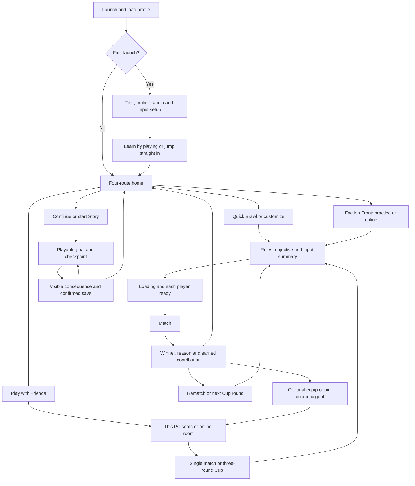

# Build Custard Knights into shared evenings

## Owner scope decision — 13 October 2026

The owner now accepts **50v50 as the maximum for this release: 100 total combatants, including bots**. The earlier 100v100/200-total request is deferred to later scope and is no longer a first-release gate. Keep 4v4/20v20/50v50 and their actual performance, networking, human and device acceptance requirements; bot capacity is not a validated 100-human service. Historical 200-total research below remains future design material. Native two-sofa play, the complete causal story and other advertised first-release commitments are unchanged.

Use Astra Ultra sparingly for bounded reviews of the causal story/experience, difficult couch/online integrity and the frozen release candidate. Supply exact source, gameplay captures, evidence and remaining questions; require prioritised findings and acceptance criteria. Sol implements/integrates, Luna performs focused checks, and Astra revisits only major architectural changes or unresolved high-risk findings. At the reduced cap there is no current 200-capacity engineering/audit task. Human, physical-device, WAN and Steam gates still require actual evidence.

13 October 2026 · Research and implementation plan · Documentation only

Custard Knights should become a readable, funny social brawler that friends can start easily, play as a satisfying Custard Cup, and revisit for combat mastery, cosmetic identity and an authored adventure. The current private beta already supplies substantial arena, Cup, collection and faction machinery; its mode count is not the main gap. The next work must connect menus, input ownership, match explanations, results, rematches and story consequences into complete journeys. **The planning baseline was beta.7 at runtime `6f1300b6f5e7dab9f31b684e60d1cadd2bbc5842`; the stronger bakery story, two-sofa native networking, persistent public parties and 100v100 battles are proposals or unfinished work.** Current verified build identity and later scoped progress are recorded in PREVIEW-BUILD.md and ORCHESTRATOR-QUEUE.md; this research baseline does not supersede them. Technical checks cannot establish fun, musical fit, physical-controller usability, real household networking or Steam readiness. Deliver small checked tasks, preserve the accepted rounded art and existing saves, and use observed people to decide which changes improve the experience. This plan neither changes the game nor authorizes platform payment, publication or new paid generation.

## One front door should lead to a complete session

The proposed identity is expressive knight combat for friends of mixed experience, on one PC or across PCs, with solo story and practice available between gatherings. Quick combat, recoverable mistakes, custard incidents and a finite group session supply the product promise. Boomerang Fu demonstrates a comparable combination of simple controls, tactical deflection, power-ups, configurable rules and friends against AI; this is a useful product reference, not retention evidence. ([Developer description](https://www.boomerangfu.com/))

Source inspection at documentation baseline `937cb80` shows a home grid that accumulated Quick Brawl, Modes & Arenas, Online, Wardrobe, Couch Party, Cup, Story and Faction Front. The replacement should use a bakery/castle scene with the accepted knight as its focal point and **four routes: Quick Brawl, Story: The Great Pudding War, Play with Friends, Faction Front**. A stable utility strip holds Wardrobe, Options, How to Play and Quit. Cup belongs in the social/arena format picker and remains accessible alone; custom setup is available beneath Quick Brawl. Returning players see Continue Story with the named objective and a visible summary of remembered safe arena rules. No mode or difficulty changes silently. ([Frozen home implementation](https://github.com/joshharris-sparkedfm/custard-knights/blob/6f1300b6f5e7dab9f31b684e60d1cadd2bbc5842/index.html#L230))

First launch offers accessible settings before the opening and a short playable lesson without forced account creation or reporting. Story teaches its mechanics in context. Menus need one input contract: activate with A/Enter/Space, go back one level with B/Escape, spatial controller navigation and logical Tab order, visible focus, restoration after rerender/modal, and no activation behind a modal. Preserve selections on Back. The options inventory must verify remapping, right-stick aim, deadzones, hold alternatives and text scaling before exposing promises. Microsoft provides useful input, focus and readable-text guidance; its rendered-text targets require actual screen measurement rather than treating CSS font size as acceptance. ([XAG107](https://learn.microsoft.com/en-us/xbox/accessibility/xbox-accessibility-guidelines/107), [XAG112](https://learn.microsoft.com/en-us/xbox/accessibility/xbox-accessibility-guidelines/112), [XAG101](https://learn.microsoft.com/en-us/xbox/accessibility/xbox-accessibility-guidelines/101))

**Mouse and controller aiming already have source support; the user's difficulty aiming is an ergonomic issue still requiring acceptance.** Arena, solo Story and Cup share mouse aim/left-click fire and right-stick aim; Faction Front has a separate implementation. The contract is keyboard/WASD movement independent of mouse world aim, or left-stick movement independent of right-stick aim, with correct per-mode fire/heavy/guard prompts. Arena currently draws only a mouse crosshair; controller aim needs a visible cue and Faction needs a reticle. Arena neutral-stick movement resets facing, whereas Faction retains stick aim; harmonize and explain the intended retention/deadzone policy rather than claiming parity already passes. Expose appropriate tuning, avoid jitter, and bind pointer/pad actions to the owning seat without stealing a couch partner. Physically test ranged shots while moving, stopped and crossing camera/UI boundaries, plus menu/device reconnect. Story remains solo. ([Focused audit](research/2026-10-13/ranged_input_audit.md), [Arena source](https://github.com/joshharris-sparkedfm/custard-knights/blob/937cb80/index.html#L1037), [Faction input](https://github.com/joshharris-sparkedfm/custard-knights/blob/937cb80/game/mass-battle-ui.js#L114))

Setup shows people, labelled bots, teams, mode, map, Classic/Roomier, difficulty, chaos and duration. Advanced probabilities and exclusions belong in an expandable rules explanation. Join-by-code accepts pasted codes and harmless whitespace, provides explicit Join and clear missing/full/incompatible-room recovery. A share link must never reveal a private host credential. Loading displays who is ready and what is waiting. Offline/story pauses; shared couch pause applies to every seat with clear ownership. Online opens “Match menu — match continues”, releases that seat's held input, and supplies Resume/Options/Leave. Controller loss pauses local play and offers reassignment; online uses a declared neutral-input/timeout policy. Current implementations differ across arena, faction and ranked, so a visual reskin alone cannot deliver this contract.

Results explain who won and why before standings, objective contributions and factual awards. Rematch is primary; Change Rules and Leave are secondary. Reward Equip/Keep Look never steals rematch focus. Wardrobe retains locked try-on, gameplay-size preview, pinned goals, three outfits and backup/import, using category tabs and a goal drawer instead of a growing card wall. Save failure never presents success; recovery offers retry/backup. Host loss states the actual end-room/recovery outcome. Native PeerJS recovery must not be promised merely because the private faction ladder has reconnect reservations.

The Refero research actually inspected Playdate, Wayfinder and Duolingo full styles, Xbox session-code and Discord invite screens, and Xbox's four-screen code flow. Use Playdate's single focal object and hierarchy, Wayfinder's illustrated world composition, and Xbox/Discord's isolated invite task and recovery. Reject tiny ghost controls and wholesale brand/token copying. The Xbox flow did not show successful joining and cannot certify that path. Lock Custard Knights' cream/yellow/deep-purple identity, rounded models, both visors and readable controls as primary references. ([Playdate](https://play.date), [Wayfinder](https://wayfinder.nfb.ca), [Duolingo](https://www.duolingo.com), [Xbox flow](https://refero.design/flows/7711), [Xbox screen](https://refero.design/pages/a0dc8e6f-b194-47d8-b697-a4056d398a35), [Discord screen](https://refero.design/pages/d7c2a6fd-a07f-476c-bb97-9c172fb8c3e5))

## Stable parties make rivalry and teamwork last

A persistent social room should preserve each person's seat, device, human key, outfit, team, votes and readiness across results, options and another Cup. Host authority changes shared rules, not another person's cosmetics or input. Departures do not shift seats or leave an absent readiness requirement. Late arena entrants join the next eligible round; late Cup entrants wait until the next Cup's standings. Host migration, authenticated party persistence and guest multiseat admission require explicit implementations rather than optimistic copy. ([Current Cup state](https://github.com/joshharris-sparkedfm/custard-knights/blob/937cb80/game/cup.js), [Host/guest ownership](https://github.com/joshharris-sparkedfm/custard-knights/blob/937cb80/index.html#L2916))

| Arrangement | Existing boundary | Work and acceptance before a promise |
|---|---|---|
| Solo | Arena bots and single-player story exist | Uncoached learning, complete story and save/resume |
| One sofa, 2–4 people | Four local arena seat cards exist | Physical mixed keyboard/pads, four pads, TV readability, reconnect and repeated Cup |
| Individual native guests, up to 8 arena humans total | Each remote connection owns one knight | Real household create/join/rematch and failure sessions |
| Host sofa plus individual guests | Host local seats plus remote peers exists | Test 2 host-local + 2 remote; separately 4 host-local + 1 and +4 remote connections |
| Two sofas, 4+4 across two PCs | Native guest multiseat is absent | Versioned seat admission, per-seat input/identity/rewards/ready/vote, reconnect and eight-seat tests |
| Remote Play Together | Separate streamed local topology; compatibility unaccepted | Private Steam stream/device/latency tests; cannot count as native multiseat or eight connections |
| Faction couch | UI has one localId/camera | Separate design decision and implementation; arena couch does not prove it |
| Team play against bots | Reuse compatible team arenas | Verify allocation, friendly-fire policy, teamwork feedback and chosen difficulty |
| Co-op Story | Current story is solo | New checkpoint, scaling, revive/leave and ownership design if later commissioned |

Steam Remote Play Together streams the host's local game; its ownership and input arrangement differs from native replication. Ultimate Chicken Horse's official support provides examples of mixed local/remote seats and streamed keyboard/controller constraints, but neither source establishes Custard Knights compatibility. ([Valve Remote Play](https://partner.steamgames.com/doc/features/remoteplay), [Mixed-play support](https://cleverendeavourgames.freshdesk.com/support/solutions/articles/32000028877-can-i-play-with-people-locally-and-online-at-the-same-time-), [Streaming support](https://cleverendeavourgames.freshdesk.com/support/solutions/articles/32000028878-how-do-i-use-steam-remote-play-))

The existing individual Cup is FFA, King of the Pie and Hot Pie, each capped at 120 seconds. Preserve that as the recommended bounded social package. Reveal its three goals, carry standings between rounds, show one earned moment, then offer Another Cup/Change Rules/Leave. **An 8–12-minute Cup, 30–45-minute optional gathering, and under-90-second launch for an already-onboarded ready group are proposed UX targets, not measured durations.** Team matches belong beside Cup; a Team Cup requires compatible selection and shared scoring, and is later optional scope.

Start novice groups with respawning combat. In elimination modes, show remaining lives/participants and a time ceiling; audit chicken involvement so eliminated players cannot choose the winner through unlimited revenge pecks. Measure truly idle time and repeated domination before adding modes. A proposed recommended-path target is no idle segment over 30 seconds; revise the rotation when observation shows disengagement. Team contribution should recognize attributable capture, return, defence and assists, rather than kills alone. Optional winning-moment recap remains dependent on real capture work.

Fairness means equal base competitive statistics, disclosed bot difficulty and match-local upgrades. Existing weapon levels cap at three, survive swaps/ammo exhaustion within that life, and reset on death. Preserve that ceiling and test snowballing with mixed-skill people. No paid damage, hidden novice bonus or absence penalty. Easier bot practice and visible team agreement supply immediate support. Any later self-score handicap belongs to a labelled private unranked preset and requires scoring/UI work; Ultimate Chicken Horse documents a voluntary self-handicap example without proving its suitability here. ([Score-balancer support](https://cleverendeavourgames.freshdesk.com/support/solutions/articles/32000028992-how-to-use-score-balancer))

Return value should have three concrete forms: another Cup with the same friends; a new counter/weapon/objective mastery or desirable cosmetic; and a meaningful story checkpoint. Full base combat and the host's arena rules stay available to visiting guests. Clarify local profile, temporary guest and authenticated account ownership before promising Steam Cloud rewards to everyone. Preserve once-only receipts, legacy ownership and optional goals during absence. Daily streaks, expiring chores and permanent competitive stat growth do not solve the identified gap. One recommended playlist avoids prematurely splitting every mode/region/size into empty public queues; retain custom rules and expand public choices only from actual population evidence.

## Playable consequences should carry the bakery story

The owner rejected the story's quality. Source evidence explains a structural problem: **seven of eight campaign nodes use courtyard, and the default results continuation can bypass aftermath**. Attractive scenes cannot by themselves create distinctive places or causal action. The current bakery direction is authored, not implemented; interrupted untested bakery work in the original checkout is not beta.7 and must first be inspected as WIP under a bounded resume task. Preserve frozen exports while improving the chapter. ([Campaign source](https://github.com/joshharris-sparkedfm/custard-knights/blob/937cb80/game/campaign.js), [Campaign UI](https://github.com/joshharris-sparkedfm/custard-knights/blob/937cb80/game/campaign-ui.js), [Story direction](https://github.com/joshharris-sparkedfm/custard-knights/blob/937cb80/release/STORY-EXPERIENCE-DIRECTION.md))

| Chapter beat | Playable cause and consequence | Definition of done |
|---|---|---|
| Bakery and banquet | Meet Mabel; deliver trays; Steve steals scraps; disruption forces pantry rescue | Familiar person/place established; returning/retrying player can skip long opening |
| Pantry and forecourt | Break blockage, escort three cooks, return to supplies and visible siege bowl | Rescued people react and contribute; reachable escort/exit/reset; default aftermath |
| Cooling channel | Stirling protects route; safe bridge landings; optional biscuit practice | Destination follows siege problem; optional lesson never blocks critical route |
| Steve and winch yard | Free/ride food-motivated Steve through marked service gates | Destination established before control; mount/input/camera parity |
| Rind and trapped guard | Meet guard beforehand; free them during safe boss interval; Rind witnesses it | Readable two phases and rescue; alliance follows action rather than exposition |
| Sluice and homecoming | Cooks provide tools, Stirling covers approach, Rice shields help; player diverts bowl and walks home | Immediate siege resolved, familiar bakery changed, completion/spoons saved once; Spoon hook follows closure |

Use bakery forecourt, pantry/service lane, cooling channel and winch yard as authored spaces with different routes and pace. Reuse combat, breakables, escort, mount and hold-area mechanics rather than adding cinematic-only promises. Alternate pressure, movement, discovery and brief safety; retries repeat essential goal context rather than entire scenes. Saved node IDs/replay mapping must remain compatible or receive explicit migration. Optional spoons and assistance remain. Later kingdoms do not need construction to finish this chapter. Supergiant's Bastion account supports concise narration responsive to visible play; Valve's Left 4 Dead presentation supports breathing room distinct from difficulty. These principles inform the proposal, without importing either game's systems wholesale. ([Writing Bastion](https://www.supergiantgames.com/blog/in-depth-writing-bastion/), [Valve AI presentation](https://cdn.fastly.steamstatic.com/apps/valve/2009/ai_systems_of_l4d_mike_booth.pdf))

Distinct faction silhouettes must appear in live gameplay, not only a cinematic costume callback. Custardia uses round saucepan/bell armour, aprons and bakery insignia; Rice uses broad bowl shields, stepped plates and grain crests. Angelic Delight remains a style bible until gameplay scope exists. Role signals remain independent: shield breadth for Vanguard, bow/quiver for Ranger, tools/pack for Engineer, banner/satchel for Support. Keep rounded anatomy, both visors, matched hitboxes and equal faction statistics. Cosmetics cannot disguise faction, attack reach or threat role. Review grayscale/silhouette and actual-size crowded frames by facing, visor and equipment; fix systematic confusion before atlas production. Valve's TF2 art paper supplies the silhouette/architecture readability method, not characters to copy. ([Valve art paper](https://steamcdn-a.akamaihd.net/apps/valve/2007/NPAR07_IllustrativeRenderingInTeamFortress2.pdf))

Production begins with an asset ledger: existing owned models, accepted turnarounds, both visors, equipment sockets, environment sheets, font licences, music provenance and **earlier generated videos still awaiting location**. Locate and catalogue those videos by file/service ID, hash, beat, characters, duration, audio and rights before deciding replacements. Current game-rendered scenes are not recovered prior videos. Adobe capabilities were inspected for vector/raster export, layout, fonts and timeline/audio work; no assets were uploaded or modified. Higgsfield's inspected Kling 3.0 capabilities include start/end references and 3–15-second shots; no generation ran. Capability is not quality, consistency, licensing or cost approval.

Lock a contact sheet and forbidden character drift, then make a low-cost animatic from owned stills/actual game capture. Shot briefs specify beat, one action, start/end references, duration, camera, safe area, continuity and acceptance. Selected 4–8-second establishing/reveal/homecoming shots are proposals. Keep rescues and final actions playable. Generate only missing approved shots within a checked per-shot/total budget; record model/settings/output/provenance. Preserve editable captions and audio stems, verify every frame, actual Electron offline codec playback, skip/replay/fallback and callback idempotency. Subtitle size/background/speaker cues work before the first frame; essential audio has captions. ([XAG104 captions](https://learn.microsoft.com/gaming/accessibility/xbox-accessibility-guidelines/104))

All 13 music cues already exist; audition them before requesting more. Test speakers/headphones, fit, transitions, loudness, loop seams and the documented Another Helping tail. CK-09 still needs a warning-priority mixer and banner arbitration so critical hazards/objectives survive music, jokes, rewards and Insane overlap. Trailer and store screenshots use actual accepted gameplay for gameplay claims; generated cinema cannot demonstrate 200-human capacity. A game build, musical approval, story approval and asset-rights/disclosure record are separate deliverables.

## Online scale needs explicit engineering and evidence gates

Faction Front currently offers 4v4/20v20/50v50, **8/40/100 total combatants including bots**, and the owner accepts 50v50 as this release's maximum. 100v100 means 200 total and remains deferred future engineering, not a renamed 50v50 preview or a release blocker. A recorded 100-socket separate-process workload used roughly 205–212 Mbps aggregate application payload, excluding TCP/TLS/WebSocket overhead, at around 20 broadcasts/sec and had failed client-input timing on all three hosts; Linux recorded a 1.77-second receive gap. A later same-host headless-browser-plus-99-scripted-clients sample was smoother but did not prove sustained congestion, WAN, minimum hardware or 100 humans. ([Process-load review](https://github.com/joshharris-sparkedfm/custard-knights/blob/937cb80/qa/reviews/battle-process-load-2026-10-09.md), [Later diagnostic review](https://github.com/joshharris-sparkedfm/custard-knights/blob/937cb80/qa/reviews/sales-readiness-2026-10-09.md))

| Gate | Engineering work | Evidence required before expanding claim |
|---|---|---|
| 8 total | All three objectives/four roles; authority, bot replacement, input/result/reconnect policies; first regional endpoint | Full human WAN 4v4, named devices, graceful failures |
| 40 total | Separate-host scripted workload and rendered central congestion; roles/projectiles/abilities | Full-duration mixed sessions; actual 40-human event for a 40-human promise |
| 100 total | Intended host/client budgets, regional allocation and cost; all three objectives | Distributed load, mixed sessions and scheduled 100-human acceptance |
| 200 total — deferred | Future versioned capacity, wider routes/spawns, spatial/AI budgets, relevance and replication work | Outside this release; require a new engineering/acceptance milestone before any 200-total claim |

Browser WebSocket lacks built-in backpressure; use bounded queues, coalescing, atomic full resync, parser/message limits and an explicit slow-client policy. Profile dirty fields, quantisation, relevance and cadence before doubling all-to-all state. Bots stress AI/simulation, remote clients stress replication, rendered clients stress presentation, and household networks stress transport. None substitutes for the others. ([MDN WebSocket](https://developer.mozilla.org/en-US/docs/Web/API/WebSockets_API), [Epic replication guidance](https://dev.epicgames.com/documentation/en-us/unreal-engine/replication-graph-in-unreal-engine))

The following are **initial proposed budgets**, to revise with named hardware/provider measurements. Target 60 FPS at selected 1080p quality, frame p95 ≤20ms and p99 ≤33ms; physical local response p95 ≤100ms, measured separately from confirmed hits. Target 30Hz simulation with work p95 <16ms/p99 <25ms, 30% CPU headroom and no catch-up spiral. Target 20Hz near/critical replication, clean-regional p99 receive gaps ≤150ms, decode/apply p95 ≤2ms/p99 ≤4ms. Initial bandwidth goal is ≤0.5Mbps average/client and ≤1Mbps p95 over one-second windows, with wire overhead separately measured: 200 clients at 0.5Mbps is 100Mbps payload, about 45GB/hour decimal before overhead. Choose memory caps from evidence, keeping steady RSS ≤70% and peak <85% of the selected cap. These figures are neither measured passes nor Steam standards.

Test RTT 30/80/150ms, jitter 20/50ms, loss 0/1/3%, 5–20-second outages, constrained bandwidth and server restart separately. Clean regional service must meet the accepted responsiveness budget; impaired sessions must degrade honestly without wrong results or unbounded queues. Current deployment is loopback and no public endpoint exists. DNS/WSS/origin restrictions, secrets, rate/capacity controls, metrics, alerts, backups/restore, maintenance/update policy and a support/incident owner precede promotion. A healthcheck does not ensure restart; restart does not recover memory-only live matches. ([Deployment boundary](https://github.com/joshharris-sparkedfm/custard-knights/blob/937cb80/deploy/README.md))

Private ladder identities, SQLite ratings, duplicate-safe result replay and cumulative 20-second reconnect grace exist. Individual queues are not persistent parties or Steam ownership. Steam ticket verification and ownership checks need a backend adapter, credential handling and real account acceptance. Public ranked additionally needs party-aware assignment, calibration, abuse/anti-collusion policy and auditable outcomes. Review the private policy that pauses an entire battle and forfeits a faction after one person's grace expires before exposing it to 100/200 people; preserve versioned current behavior until a deliberate replacement passes. ([Private ladder](https://github.com/joshharris-sparkedfm/custard-knights/blob/937cb80/release/PRIVATE-LADDER.md), [Valve authentication](https://partner.steamgames.com/doc/features/auth))

## Checked tasks should end in observable acceptance

Implement in the following order, recording one reviewable task at a time. Dependencies name real prerequisites; asset location and platform inputs must not stop independent menu/combat/service work. The owner authorizes pushing and merging each completed checked repository task; the orchestrator handles Git. The explicit renewed 13 October /loop request supersedes the earlier automation-removal instruction; active `custard-knights-build-orchestrator` runs every 30 minutes using [ORCHESTRATOR-QUEUE.md](ORCHESTRATOR-QUEUE.md), starting with the bounded ranged-aim prerequisite after the read-only FE-01 inventory. Research changed documentation only; it did not change/build the game, generate media or publish a release.

| ID / priority | Work and dependencies | Definition of done |
|---|---|---|
| FE-01 / P0 | Baseline/WIP inventory; first | Freeze claims and hashes; inspect interrupted bakery changes without assuming acceptance; preserve exports/saves; identify intended patch |
| FE-02 / P1 | Reference/asset lock; FE-01 | Approved game contact sheets/menu composition; asset/font/media provenance; existing-video search recorded; bounded missing-shot list |
| FE-03 / P1 | Navigation and four-route home; FE-01/02 | Fresh/returning profiles, all routes/modal/back/focus, loading/error/pause/results on keyboard/mouse/pad; no seat-state regressions |
| FE-04 / P1 | Input and couch ownership; FE-03 | Verified action vocabulary/remap/aim options; 1/2/4 physical seats, pad reorder/reconnect, five rematches, Cup and TV readability |
| FE-05 / P1 | Persistent arena room/Cup; FE-03/04 | Three rounds plus second Cup preserve seats/rules/appearance; ready/departure/late-arrival/host-loss paths and honest scores |
| FE-06 / P1 | Combat/weapon/race/map clarity; FE-04 | All eight modes and six maps/both sizes; visible hit/counter/peck parity, level-three reset, safe spawns and measured encounter density |
| FE-07 / P1 | CK-09 mixer/banner priorities; FE-06 | Warning arbitration/ducking/voice limits under overlaps; reduced flash/motion preserved; recorded frame/audio acceptance |
| FE-08 / P1 | Bakery opening slice; FE-01/02/03/06 | Bakery→pantry→visible siege consequence playable; checkpoint/skip/retry/migration; uncoached stake/action understood before extending |
| FE-09 / P1 | Causal middle and closure; FE-08 | Channel/Steve/Rind rescue/sluice/homecoming; every fail/retry/save/replay path; humans understand causality and earned local resolution |
| FE-10 / P1 | Faction/role art and media integration; FE-02/06/08 | Live silhouette/visor/socket/crowd checks; approved necessary shots/music/captions; no hitbox or asset drift |
| FE-11 / P2 | CK-22 bounded experiment; FE-05/07 | One deterministic explained House Rule with vote/tie/default/fallback; attributable chain trigger; normal-vs-rule human fairness review |
| FE-12 / P2 | CK-24 local sharing/creator preparation; FE-05/07 | Opt-in actual-gameplay postcard/capture, name privacy, local export, measured cost; tiny recipient pilot and honest activation evidence when explicitly authorized |
| FE-13 / P1 | Native WAN and guest multiseat; FE-04/05 | Supported host-sofa WAN passes first; new versioned 4+4 admission/input/ready/vote/reward/reconnect passes before advertising two sofas |
| FE-14 / P1 | Public service and identity/party foundations; FE-01/05 | Faked adapters tested independently; approved deployment then real endpoint/auth/party/rejoin/restore/abuse acceptance |
| FE-15 / P1 | Capacity up to 50v50; FE-06/10/14 | 8→40→100-total gates independently recorded; actual human scope accepted before corresponding claim. 100v100/200-total is deferred by the owner |
| FE-16 / P1 | Reliability/native-fault investigation; FE-01 onward | New bounded hypothesis, dumps/environment isolation; prove tooling boundary or fix game/service fault; named minimum-PC profiling |
| FE-17 / P1 | Human discovery and revision; FE-05/08, then affected tasks | Solo/group findings separated, voluntary continuation/stopping reasons recorded; revise repeated confusion/domination/drag, retest changed hypothesis |
| FE-18 / P1 | Candidate freeze/package; all advertised tasks | Affected regressions, manifest/hash, isolated legacy/fresh saves, second-PC actual EXE/full devices; no open P0/P1 |
| FE-19 / external | Steam evidence pack/installation; FE-18 + account access | Claims map, real screenshots/trailer, AI disclosure, supported hardware/install/Input/overlay; store/build review and account eligibility confirmed |

Use specialist lanes with one orchestrator owning dependencies, claims, merge readiness and scope. Use Sol for synthesis/integrated implementation and Luna for bounded audits or simple tasks; escalate to Astra only when task complexity warrants it. Estimates below describe task size, not promised dates: S is a bounded correction/review, M an integrated feature with focused regression, L a milestone requiring multiple checked tasks.

| Accountable lane | Task ownership / indicative size | Independent check |
|---|---|---|
| UX and player journey | FE-02/03/04/05: M | QA plus physical couch participants |
| Narrative and creative production | FE-08/09/10: L; FE-02 media inventory: S | Fresh solo story review, art/readability and listening review |
| Combat and systems | FE-06/07: M; FE-11/12: M | Authority/input QA and mixed-skill groups |
| Networking and services | FE-13/14: L; FE-15: staged L | Distributed load, WAN participants and operations reviewer |
| Release and independent QA | FE-01: S; FE-16/18/19: L; FE-17: repeated bounded M | Reviewer other than implementer; owner/platform acceptance stays separate |

The full [acceptance matrix](ACCEPTANCE-MATRIX.md) defines mode objectives, failure/reward/reset coverage and cross-cutting journeys. Maintain separate columns for coding completion, automated evidence, physical/WAN/human acceptance and external platform approval. Original CK-01–24 remain reconciled below; implemented work gets affected regression and outstanding acceptance rather than unnecessary rewrites.

| Original requirements | Plan work / retained acceptance |
|---|---|
| CK-01 / 02 / 03 | FE-04/05/13/18: seats, authoritative per-person rewards, legacy saves and once-per-household policy |
| CK-04 / 05 | FE-17: retain default-off local reporting and optional solo assignment; collect real baseline/first-fight evidence; referral attribution remains open |
| CK-06 / 07 / 08 | FE-06/10: cues, host/guest feedback, input including original touch criterion, hitboxes, reachable hazards and markers |
| CK-09 | FE-07: warning mixer and banner priority remain partial until implemented/accepted |
| CK-10 / 11 / 12 / 13 | FE-08/09: authored independent encounters, prerequisites/spoons/save, contextual shield learning and Rind rescue without softlocks |
| CK-14 / 15 / 16 | FE-05: three-round human winner/tie, ready/room continuity and factual awards |
| CK-17 / 18 | FE-03/10/17: accurate collection, six-item capsule/earning routes, both visors, human equip/desirability |
| CK-19 / 20 / 21 | FE-16/17/18: unresolved reliability plus human evidence; eight nodes exist but CK-20 gate was not satisfied before expansion |
| CK-22 | FE-11: House Rule and attributable chain reaction are missing, not satisfied by chaos/map voting |
| CK-23 | FE-18/19: packaging exists; intended hardware/Steam installation/overlay/Input remain open |
| CK-24 | FE-12: trailer/invites do not complete runtime sharing/capture-cost/creator activation |
| Newer owner requests | FE-03–10/13–15: whole journey, stronger story, rounded distinct factions, mouse/ranged/race/upgrades, Roomier density, online+couch longevity, parties and public ranking. Latest owner cap is 50v50/100 total; 200 total deferred |

Use the first human social round as a **proposed discovery sample of six groups/24 people**: two four-person mixed-skill sofa groups, two all-remote groups, two 2-host-local+2-individual-remote groups. Observe optional 30–45-minute sessions, recording help, build, hardware, input and networks. Separately accept 4-host-local+1/+4 remote engineering capacity, then 4+4 after guest protocol work. Include fresh solo story/first-fight participants separately; offer a voluntary seven-day return opportunity and report actual people/groups, choices and reasons. This sample cannot estimate population retention. Ask what hit them, why scores changed, what they are saving, which character changed and what they choose next before explaining intended answers. Reporting stays opt-in/local; compensation must not depend on continuation. Valve's playtesting presentation supports observing behavior alongside verbal reports. ([Valve playtesting](https://cdn.fastly.steamstatic.com/apps/valve/2009/GDC2009_ValvesApproachToPlaytesting.pdf))

Treat crash/data loss/security as P0; blocked input/progression/objective/results and severe repeatable stalls as P1. Candidate releases have zero open P0/P1 in advertised scope. Repeated P2 confusion/balance needs revision or an explicitly accepted limitation with evidence. The unexplained local Node access violations and Python anomalies remain open despite independent Windows/Linux CI success; investigate under a new hypothesis rather than rerunning unchanged failures until lucky. An actual package/service reproduction blocks release; a tooling-only boundary requires evidence.

Steam requires distinct store/build approvals, store submission first, a mostly final advertised build and a public Coming Soon period of at least two weeks; approval does not publish automatically. Current onboarding documentation states a 21-day first-title fee-to-release wait, conflicting with older project wording, so confirm actual account eligibility rather than promising a date. Prepare account/company/bank/tax/App/depot inputs and allow review time. ([Release process](https://partner.steamgames.com/doc/store/releasing), [Review process](https://partner.steamgames.com/doc/store/review_process), [Onboarding](https://partner.steamgames.com/doc/gettingstarted/onboarding))

Prepare current capsule sizes (920×430 header, 462×174 small, 1232×706 main, 748×896 vertical), at least five actual gameplay screenshots and a gameplay-led trailer understandable without sound. Map every checkbox/claim to hash, topology and acceptance. Steam's AI survey covers shipped generated art, audio, narrative and localisation; disclose installed Suno music and any other shipped generated material truthfully with provenance. Steam Playtest is an optional separately reviewed child-app distribution stage, not enabled by this plan. ([Graphical assets](https://partner.steamgames.com/doc/store/assets/standard), [Trailers](https://partner.steamgames.com/doc/store/trailer), [Content Survey](https://partner.steamgames.com/doc/gettingstarted/contentsurvey), [Playtest](https://partner.steamgames.com/doc/features/playtest))

The remaining external gates are hosting account/domain/budget and deployment authorization; Steam permissions/onboarding/IDs/eligibility; legal declarations/payment/public prices/publication; support ownership; actual PCs/pads/household networks; and human story/fun/music decisions. The hosting and prior-video questions are already pending and should not be repeatedly asked. Build concrete reviewable artefacts while those inputs are unavailable. Repository merge does not close these gates. Keep later kingdoms, Workshop/editor, weekly recipes, full replay and co-op Story deferred unless scope is explicitly added. Public ranking remains unfinished; 100v100 is deferred by the latest owner decision.

Evidence base: [player journey](research/2026-10-13/player_journey.md), [gameplay/story](research/2026-10-13/gameplay_story.md), [release reliability](research/2026-10-13/release_reliability.md), [social longevity](research/2026-10-13/social_longevity.md). Research used source inspection and capability/reference checks, not new gameplay or participant observations. [Roadmap ledger](https://github.com/joshharris-sparkedfm/custard-knights/blob/937cb80/release/ROADMAP-STATUS.md), [original done-when criteria](https://github.com/joshharris-sparkedfm/custard-knights/blob/937cb80/BUILD-PLAN.md), and [frozen export record](https://github.com/joshharris-sparkedfm/custard-knights/blob/937cb80/release/PREVIEW-BUILD.md) preserve the distinction between implementation and release acceptance.
